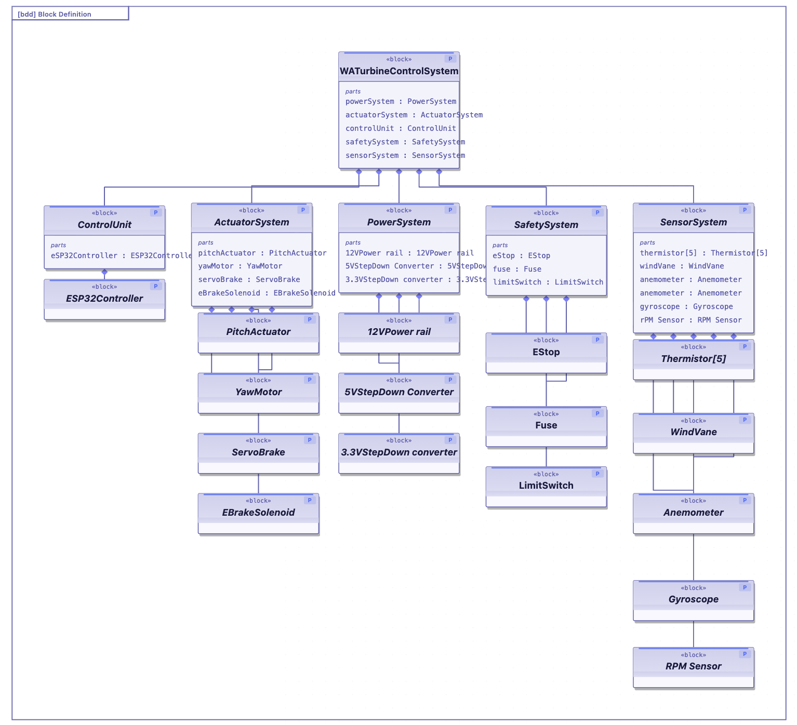
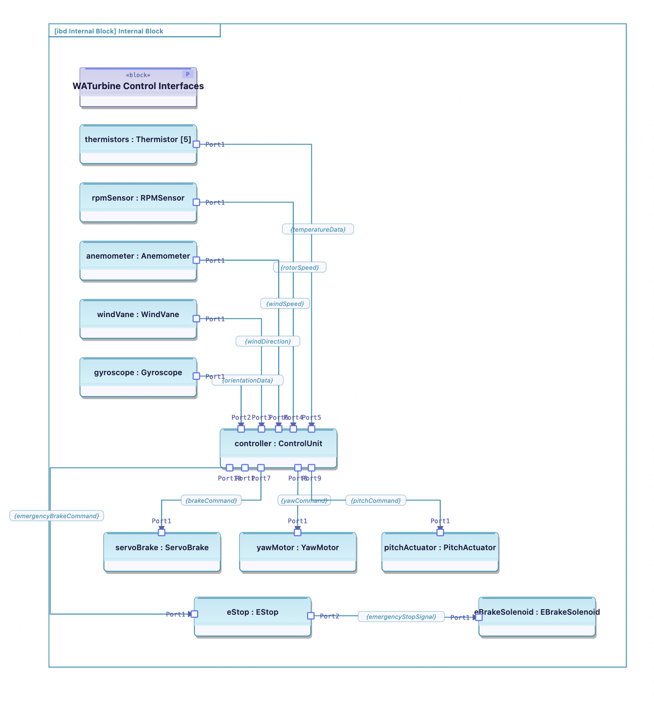
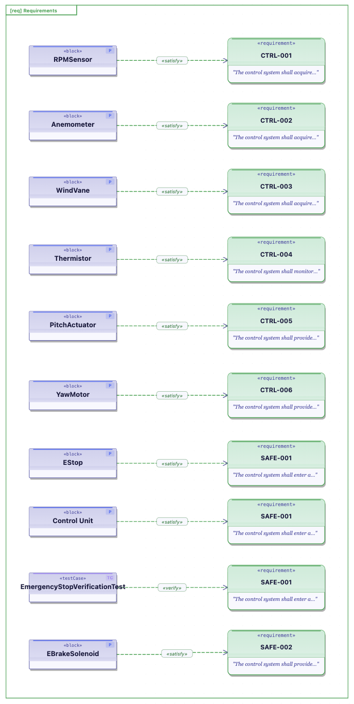

# WATurbine SysML / MBSE Model

A small SysML model of the WATurbine control system, created to explore
Model-Based Systems Engineering (MBSE), system architecture, interfaces,
requirements, and traceability.

## Block Definition Diagram

The BDD decomposes the WATurbine control system into its main subsystems:
control, sensing, actuation, power, and safety.

## Internal Block Diagram

The IBD shows how sensors, the control unit, actuators, and safety components
interact through system-level interfaces and information flows.

## Requirements & Traceability

The requirements diagram links functional and safety requirements to the
design elements that satisfy them using `«satisfy»` relationships, with an
example `«verify»` relationship for emergency-stop verification.

## Concepts Demonstrated

- SysML Block Definition Diagrams (BDD)
- Internal Block Diagrams (IBD)
- System decomposition
- Ports, connectors, and item flows
- Requirements modeling
- Requirements-to-design traceability
- Verification traceability
- Model-Based Systems Engineering (MBSE)

## Tools

- SysML v1.x
- SysML Studio (https://app.sysml.pro/)

## Scope

This model focuses on the high-level WATurbine control architecture.
Detailed PCB circuitry, embedded firmware, and mechanical design are outside
the scope of this model.
